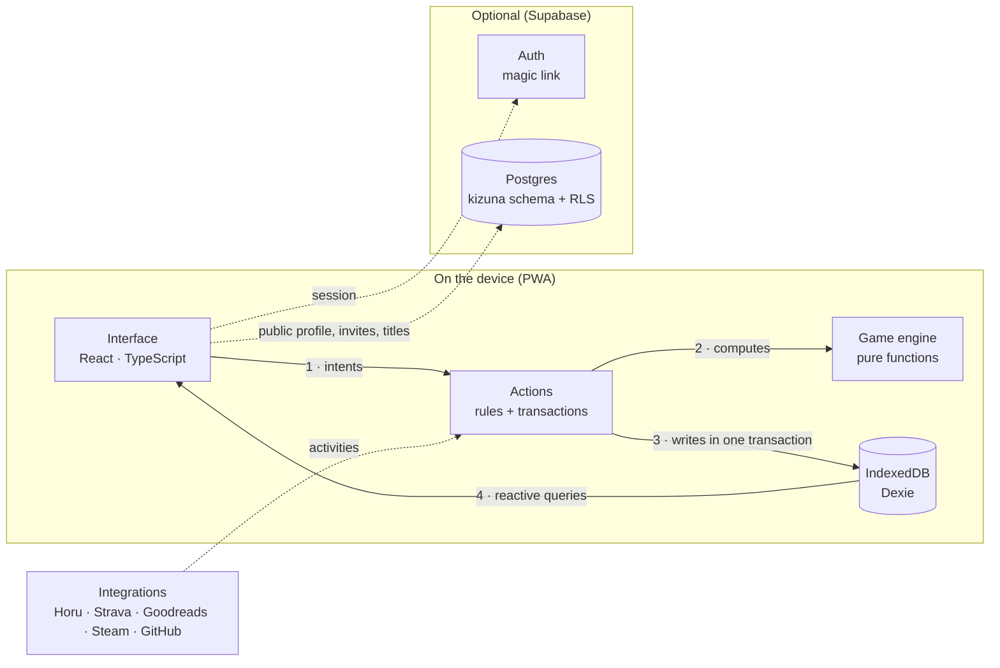
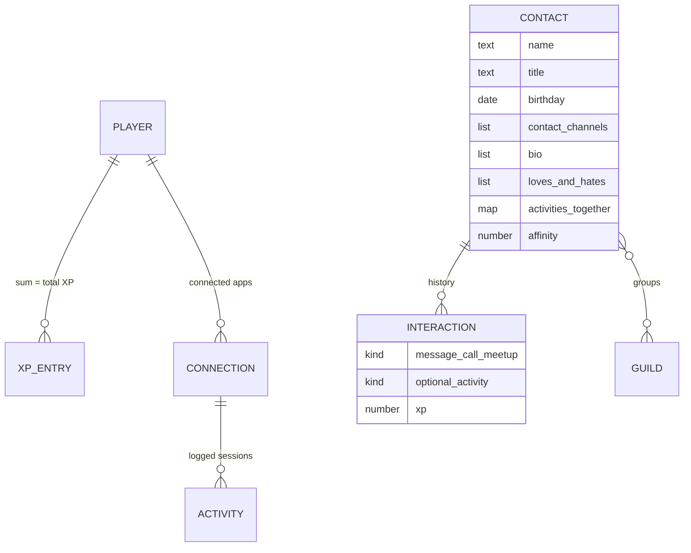
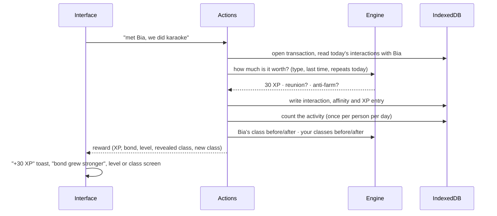
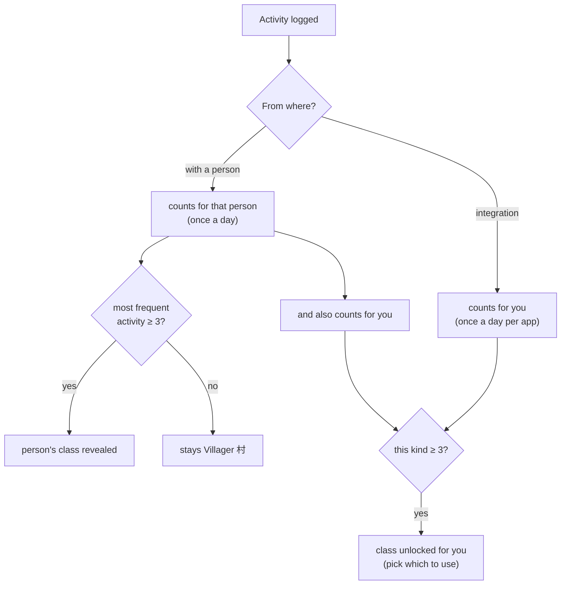
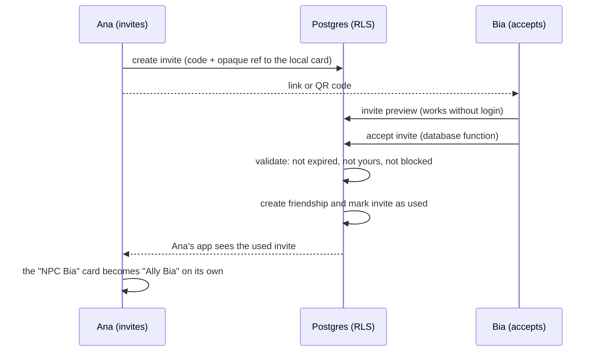

# Kizuna architecture

<a href="README.en.md">← back</a> · <a href="ARQUITETURA.md">Português</a>

How Kizuna is built inside: the pieces, where each piece of data lives, how the game
computes everything, how the social layer protects itself, and the choices (and
trade-offs) behind each decision.

---

## 1. Local-first, with an optional social layer

**The project's rule:** the interface never writes to the database directly. Every write
goes through **actions**, which run in a transaction, consult the **game engine** (pure
functions, no database or UI) and return a "reward" that the interface only celebrates.
The screen updates on its own because it reads IndexedDB through reactive queries.

| Piece | Responsibility |
|---|---|
| **Interface** | three tabs (Home, Contacts, Profile), the profile card, forms, celebrations (XP, level, new class) |
| **Actions** | domain rules: creating and editing cards, logging interactions and activities, claiming quests, backup, migration |
| **Game engine** | XP, anti-farming, levels, affinity, cadence, classes, quests and title rarity |
| **IndexedDB (Dexie)** | the only copy of personal data: cards, notes, history, XP, integrations |
| **Supabase (optional)** | only what must be shared between people; everything behind RLS |
| **Integrations** | an app catalog and a single entry point for activities |

Without Supabase keys in the build, the social code isn't even bundled: the app is 100%
local.

---

## 2. Where each piece of data lives

| Data | Where | Why |
|---|---|---|
| Cards, notes, private nickname, history | **device** | it's about another person: it stays here |
| XP, levels, classes, quests | **device** | the game is yours; works offline |
| Integration activities | **device** | personal log |
| Public profile (name, @, class, spirit, level) | cloud | it's what your allies see |
| Friendships, invites, titles, blocks | cloud | they involve two people |

**XP is a ledger.** The player's XP isn't a number we add to and subtract from: it's the
sum of entries (interaction, card, quest, activity). That keeps anti-farming verifiable,
makes quests claimable exactly once and makes backups trivially consistent.

---

## 3. Logging an interaction, step by step

Everything happens in one transaction: interaction, affinity, XP and classes change
together, or nothing changes.

### Engine rules

| Rule | How it works |
|---|---|
| XP per interaction | message 5 · call 15 · meetup 30 |
| Reunion | more than 60 days without contact: double XP |
| Anti-farming | only the first interaction of each type, per person, per day, earns XP (and only that one counts for quests) |
| Card | 10 fields earn 5 XP each, **once ever** (clearing and refilling doesn't pay); full card +25 |
| Level | leaving level *n* takes `60 + 20 × n` XP |
| Affinity | 11 levels with growing thresholds; only interactions raise it and it **never drops** |
| Cadence | past a person's cadence: *cooling* (the card fades); past 2×: *forgotten* |
| Quests | 3 per day, drawn deterministically from the date (same day, same quests, no stored state); claiming re-checks progress |
| Title rarity | the same title given by different friends: 1 common · 2 rare · 3–4 epic · 5+ legendary |

Affinity never dropping was a design choice: the game reminds you of someone, but doesn't
punish a friendship for a busy season.

---

## 4. Classes: everyone starts as a Villager

| Activity | Class | Integration |
|---|---|---|
| Training / sports | 剣 Warrior | Strava |
| Study / learning | 魔 Mage | Horu |
| Music / art / party | 吟 Bard | — |
| Supportive talk | 癒 Healer | — |
| Games | 影 Rogue | Steam |
| Reading / nature | 禅 Monk | Goodreads |
| Work / project | 商 Merchant | GitHub |
| Help / favor | 盾 Paladin | — |

- A contact's class **emerges from what you do together**, instead of being a label you
  pick. Allies (with an account) show the class they chose on their own profile.
- Your classes are **never lost**: deleting a card or disconnecting an app doesn't take
  back what you've earned.
- "Once a day" applies everywhere: logging the same workout three times in one afternoon
  unlocks nothing.

---

## 5. Integrations: manual today, automatic tomorrow

| Mode | How it works | Who uses it |
|---|---|---|
| **manual** (beta) | you connect the app and log each session | all |
| **push** | the app sends activities to Kizuna | Horu (my own project) |
| **oauth** | sign in to the service and sync through its API | Strava, Goodreads, Steam, GitHub |

Manual logging and future sync enter through **the same door**: an import function that
takes a list of activities, ignores the ones already received (each carries a source
identifier) and applies the "one per app per day" rule. Turning on a real API changes no
game rule, only the source of activities.

Strava and the other OAuth services require a client secret that **can't live in the
browser**. So they wait for a minimal server (a serverless function); the app stays
local-first.

---

## 6. The social layer and security in the database

Security choices:

- **Everything in its own schema (`kizuna`).** It can live in the same Supabase project
  as another app without clashing with its tables, which matters on the free plan.
- **Explicit grants.** Supabase no longer exposes tables automatically; the migration
  grants each verb on purpose, and RLS policies decide which rows.
- **Sensitive operations are database functions.** Accepting an invite, blocking someone
  and checking whether a handle is free run inside Postgres, validated in one transaction.
  The client can't create a friendship "by hand".

| Table | Who sees it | Who changes it |
|---|---|---|
| profiles | you and your friends | only the owner |
| friendships | both people | nobody inserts directly (invite only); either side can undo |
| invites | the inviter | the inviter creates and deletes; accepting is a database function |
| titles | the giver, the receiver and the receiver's friends (unless hidden) | only non-blocked friends can give; the receiver can only change **visibility** |
| blocks | the blocker | the blocker; blocking ends the friendship and deletes that person's titles |

These rules are tested by running the migration on a **real Postgres compiled to
WebAssembly (PGlite)**, mimicking Supabase's roles, with 22 attempts to break the system:
viewing a stranger's profile, giving a title without friendship, giving one on someone
else's behalf, editing the text of a received title, accepting your own invite, reusing a
used invite.

**Titles show up instantly** (no approval queue), because the fun is in the surprise.
Protection comes after: a simple word filter, hide, remove and block.

---

## 7. Evolving the schema without losing data

The app has already gone through a big model change (picked classes → revealed classes,
a single phone and email → contact channels, free-text likes → bio plus "loves and
hates"). Since the data lives on each person's device, the migration has to happen **in
the browser itself**, with no server:

- the local database is versioned; on open, v1 is converted to v2 automatically;
- the same normalization applies to **old backups** imported from a file;
- the migration is tested by creating a real v1 database and opening it with the new
  version.

With no cloud copy, the app asks the browser for **persistent storage** (so it isn't
cleared when space runs low) and offers a JSON backup at any time.

---

## 8. Design: *ma* × Duolingo

| Principle | In practice |
|---|---|
| **Ma (間): space** | one primary action per screen, lots of breathing room, large near-transparent kanji in the margins |
| **Paper and ink** | *washi* background, *sumi* text; cooling contacts literally **fade** |
| **Duolingo's chunkiness** | buttons and cards with a thick bottom edge that "sinks" on tap; wide progress bars with a sheen |
| **RPG card** | the profile is laid out like a character card: portrait with the guardian spirit beside it, section ribbons, icon tiles |
| **Celebration** | floating +XP, a stronger bond, level-up and new-class screens |

Palette: washi (background), sumi (ink), **shu 朱** (action), **matcha** (XP), **ai 藍**
(rare), **murasaki 紫** (epic), **kincha 金** (legendary). Type: Nunito for the interface and
Zen Maru Gothic for the kanji.

**Accessibility.** The contrast of every color pair was computed (buttons ≥ 4.5:1). In the
dark theme, text on accents flips, and class colors are mixed with the theme's ink so they
stay readable in both modes. The app honors the system's "reduce motion" and labels
visual-only controls for assistive tech.

---

## 9. How quality is verified

| Layer | Tests | What it covers |
|---|---|---|
| Game engine | 35 | XP, reunion, anti-farming, card, levels, affinity, cadence, classes, quests, rarity |
| Local data | 18 | transactions, interactions, classes from activities, integrations and dedup, quests, backup (including v1), **v1 → v2 migration** |
| Contacts | 4 | birthdays with and without a year, Feb 29, day countdown, contact links |
| Social | 7 | title moderation, NPC → ally linking, profile sync |
| Database (RLS) | 22 | the migration on a real Postgres, trying to break every rule |
| Real browser | — | full flows at phone size, light and dark themes, the screenshots on this page |

The real browser caught problems unit tests couldn't see:

| Symptom | Cause | Why unit tests missed it |
|---|---|---|
| transitions froze in automated testing | with the window hidden the browser pauses animations, and the exit one never finished | function tests don't animate; it became a test mode that drives animations through JavaScript |
| the 4th "loves" item was clipped | the row scrolled sideways on a 390 px screen | only shows up with real layout; it now wraps |
| class name unreadable in the dark theme | class colors were fixed | contrast depends on the theme; colors now mix with the theme's ink |
| the migration would break on new Supabase projects | Supabase stopped exposing tables automatically | the RLS test assumed the old grants; it now runs with no implicit permissions |

---

## 10. Deliberate trade-offs

| Choice | Gain | Cost |
|---|---|---|
| Data in IndexedDB (instead of the cloud) | privacy, offline, zero cost | data is tied to the device; mitigated with backup and persistent storage |
| Manual integrations in the beta | no server, no secrets in the browser | logging by hand until sync arrives |
| Titles without approval | instant surprise and fun | moderation after the fact (hide, remove, block, filter) |
| Public level reported by the app | simple, no game server | could be forged; acceptable in a beta among friends |
| Own schema in a shared Supabase project | fits the free plan | user accounts are shared with the other app |
| Quests drawn from the date | stateless, serverless | everyone gets the same quests on the same day |

---

© 2026 Ares. Text and images on this page: all rights reserved.
Kizuna's source code is not public.
