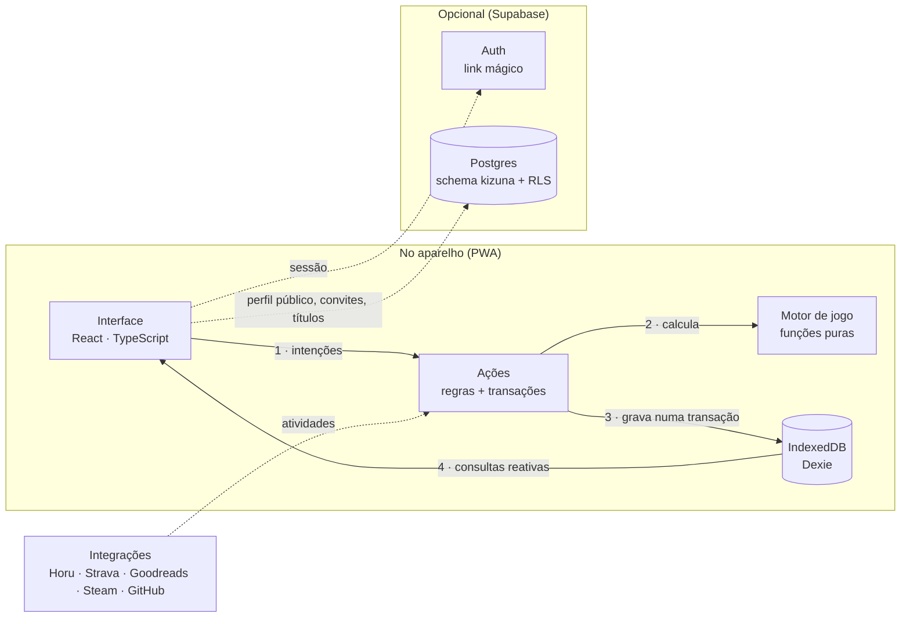
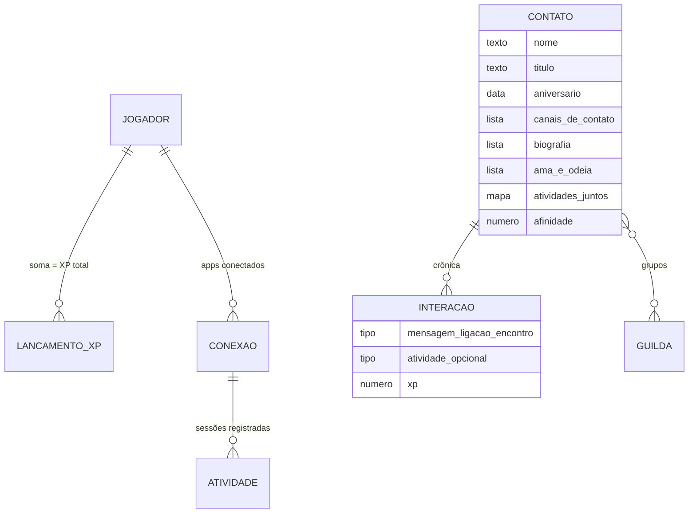
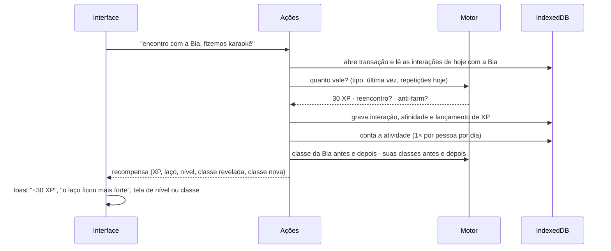
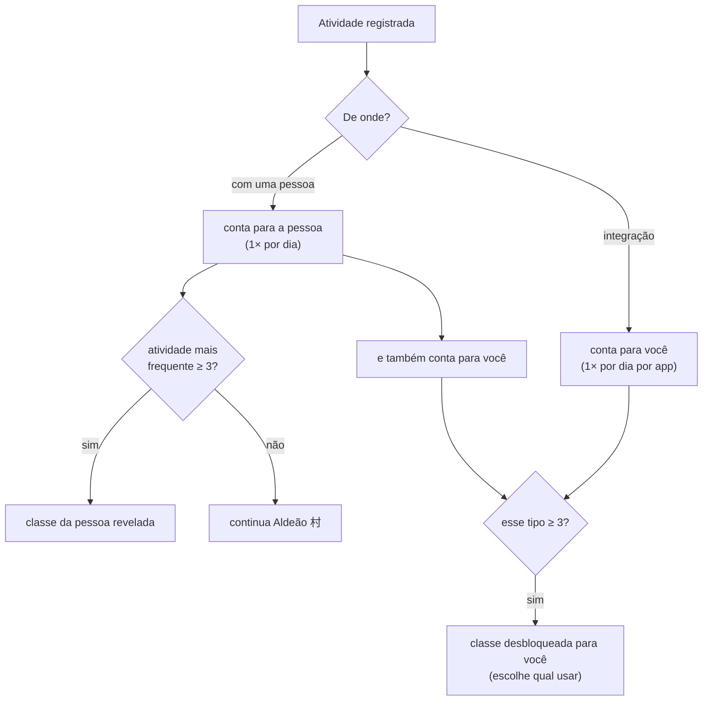
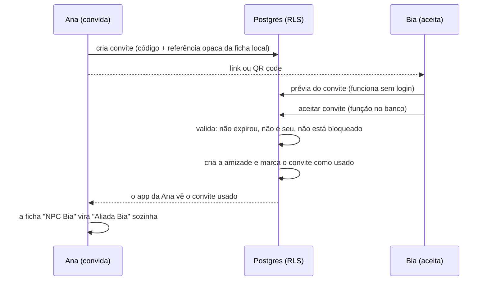

# Arquitetura do Kizuna

<a href="README.md">← voltar</a> · <a href="ARCHITECTURE.en.md">English</a>

Como o Kizuna é construído por dentro: as peças, onde cada dado mora, como o jogo calcula
tudo, como a camada social se protege e as escolhas (e renúncias) por trás de cada decisão.

---

## 1. Local-first, com uma camada social opcional

**A regra do projeto:** a interface nunca grava direto no banco. Toda escrita passa pelas
**ações**, que rodam numa transação, consultam o **motor de jogo** (funções puras, sem
banco nem interface) e devolvem uma "recompensa" que a interface só celebra. A tela se
atualiza sozinha porque lê o IndexedDB com consultas reativas.

| Peça | Responsabilidade |
|---|---|
| **Interface** | três abas (Início, Agenda, Perfil), o card de perfil, formulários, celebrações (XP, nível, classe nova) |
| **Ações** | regras de domínio: criar e editar fichas, registrar interações e atividades, resgatar missões, backup, migração |
| **Motor de jogo** | XP, anti-farm, níveis, afinidade, cadência, classes, missões e raridade de títulos |
| **IndexedDB (Dexie)** | a única cópia dos dados pessoais: fichas, notas, crônica, XP, integrações |
| **Supabase (opcional)** | só o que precisa ser compartilhado entre pessoas; tudo protegido por RLS |
| **Integrações** | catálogo de apps e uma porta única de entrada de atividades |

Sem as chaves do Supabase no build, o código social nem entra no pacote final: o app é
100% local.

---

## 2. Onde cada dado mora

| Dado | Onde | Por quê |
|---|---|---|
| Fichas, notas, apelido privado, crônica | **aparelho** | é sobre outra pessoa: não sai daqui |
| XP, níveis, classes, missões | **aparelho** | o jogo é seu; funciona offline |
| Atividades das integrações | **aparelho** | registro pessoal |
| Perfil público (nome, @, classe, espírito, nível) | nuvem | é o que seus aliados veem |
| Amizades, convites, títulos, bloqueios | nuvem | envolvem duas pessoas |

**XP é um livro-razão.** O XP do jogador não é um número que a gente soma e subtrai: é a
soma de lançamentos (interação, ficha, missão, atividade). Isso deixa o anti-farm
verificável, faz as missões serem resgatadas uma única vez e torna o backup trivialmente
consistente.

---

## 3. Registrar uma interação, passo a passo

Tudo acontece numa transação: ou a interação, a afinidade, o XP e as classes mudam
juntos, ou nada muda.

### As regras do motor

| Regra | Como funciona |
|---|---|
| XP por interação | mensagem 5 · ligação 15 · encontro 30 |
| Reencontro | mais de 60 dias sem contato: XP em dobro |
| Anti-farm | só a primeira interação de cada tipo, por pessoa, por dia, rende XP (e só ela conta para missões) |
| Ficha | 10 campos rendem 5 XP cada, **uma vez na vida** (apagar e preencher de novo não paga); ficha completa +25 |
| Nível | para sair do nível *n* são necessários `60 + 20 × n` XP |
| Afinidade | 11 níveis com limiares crescentes; sobe só com interações e **nunca cai** |
| Cadência | passou da cadência da pessoa: *esfriando* (a ficha desbota); passou de 2×: *esquecido* |
| Missões | 3 por dia, sorteadas de forma determinística a partir da data (mesmo dia, mesmas missões, sem guardar estado); o resgate confere o progresso de novo |
| Raridade de título | o mesmo título dado por amigos diferentes: 1 comum · 2 raro · 3–4 épico · 5+ lendário |

A afinidade nunca cair foi uma escolha de design: o jogo lembra você de alguém, mas não
pune a amizade por uma fase corrida.

---

## 4. Classes: todo mundo começa Aldeão

| Atividade | Classe | Integração |
|---|---|---|
| Treino / esporte | 剣 Guerreiro | Strava |
| Estudo / aprender | 魔 Mago | Horu |
| Música / arte / festa | 吟 Bardo | — |
| Conversa de apoio | 癒 Curandeiro | — |
| Jogos | 影 Ladino | Steam |
| Leitura / natureza | 禅 Monge | Goodreads |
| Trabalho / projeto | 商 Mercador | GitHub |
| Ajuda / favor | 盾 Paladino | — |

- A classe de um contato **emerge do que vocês fazem juntos**, em vez de ser um rótulo
  escolhido. Aliados (com conta) mostram a classe que escolheram no próprio perfil.
- Suas classes **nunca se perdem**: apagar uma ficha ou desconectar um app não tira o que
  você já conquistou.
- "Uma vez por dia" vale para tudo: registrar o mesmo treino três vezes na mesma tarde não
  desbloqueia nada.

---

## 5. Integrações: hoje manual, amanhã automáticas

| Modo | Como funciona | Quem usa |
|---|---|---|
| **manual** (beta) | você conecta o app e registra cada sessão | todas |
| **push** | o app manda as atividades para o Kizuna | Horu (projeto meu) |
| **oauth** | login no serviço e sincronização pela API | Strava, Goodreads, Steam, GitHub |

O registro manual e a sincronização futura entram pela **mesma porta**: uma função de
importação que recebe uma lista de atividades, ignora as que já chegaram (cada uma tem um
identificador de origem) e aplica a regra de "uma por app por dia". Ligar a API de verdade
não muda nenhuma regra de jogo, só a fonte das atividades.

O Strava e os outros serviços com OAuth exigem um segredo de cliente que **não pode morar
no navegador**. Por isso eles esperam um servidor mínimo (uma função serverless); o app
continua local-first.

---

## 6. A camada social e a segurança no banco

Escolhas de segurança:

- **Tudo num schema próprio (`kizuna`).** Dá para hospedar no mesmo projeto Supabase de
  outro app sem colidir com as tabelas dele, o que importa no plano gratuito.
- **Permissões explícitas.** O Supabase deixou de liberar tabelas automaticamente; a
  migration concede cada verbo de propósito, e as políticas de RLS decidem as linhas.
- **Operações sensíveis são funções no banco.** Aceitar convite, bloquear alguém e checar
  se um @ está livre rodam no Postgres, que valida tudo numa transação. O cliente não
  consegue criar uma amizade "na mão".

| Tabela | Quem vê | Quem altera |
|---|---|---|
| perfis | você e seus amigos | só o dono |
| amizades | as duas pessoas | ninguém insere direto (só via convite); cada lado pode desfazer |
| convites | quem convidou | quem convidou cria e apaga; aceitar é função do banco |
| títulos | quem deu, quem recebeu e os amigos de quem recebeu (se não estiver oculto) | só amigos não bloqueados dão; quem recebeu só mexe na **visibilidade** |
| bloqueios | quem bloqueou | quem bloqueou; bloquear desfaz a amizade e apaga os títulos daquela pessoa |

Essas regras são testadas rodando a migration num **Postgres real em WebAssembly
(PGlite)**, imitando os papéis do Supabase, com 22 tentativas de burlar o sistema: ver o
perfil de um estranho, dar título sem amizade, dar título em nome de outro, editar o texto
de um título recebido, aceitar o próprio convite, reaproveitar um convite usado.

**Títulos aparecem na hora** (sem fila de aprovação), porque a graça está na surpresa. A
proteção vem depois: filtro simples de palavras, ocultar, remover e bloquear.

---

## 7. Evoluir o esquema sem perder dados

O app já passou por uma mudança grande de modelo (classes escolhidas → classes
reveladas, telefone e e-mail únicos → canais de contato, gostos em texto → biografia e
"ama e odeia"). Como os dados vivem no aparelho de cada pessoa, a migração precisa
acontecer **no próprio navegador**, sem servidor:

- o banco local tem versões; ao abrir, a v1 é convertida para a v2 automaticamente;
- a mesma normalização vale para **backups antigos** importados de arquivo;
- a migração é testada criando um banco v1 de verdade e abrindo-o com a versão nova.

Como não existe uma cópia na nuvem, o app pede ao navegador **armazenamento persistente**
(para não ser limpo quando faltar espaço) e oferece backup em JSON a qualquer momento.

---

## 8. Design: *ma* × Duolingo

| Princípio | Na prática |
|---|---|
| **Ma (間): espaço** | uma ação principal por tela, muito respiro, kanji grandes e quase transparentes nas margens |
| **Papel e tinta** | fundo *washi*, texto *sumi*; contatos esfriando literalmente **desbotam** |
| **Volume do Duolingo** | botões e cards com borda inferior grossa que "afunda" no toque; barras de progresso largas com brilho |
| **Card de RPG** | o perfil é organizado como um card de personagem: retrato com o espírito guardião ao lado, faixas de seção, tiles de ícones |
| **Celebração** | +XP flutuante, laço mais forte, tela de nível e de classe nova |

Paleta: washi (fundo), sumi (tinta), **shu 朱** (ação), **matcha** (XP), **ai 藍** (raro),
**murasaki 紫** (épico), **kincha 金** (lendário). Tipografia: Nunito para a interface e Zen
Maru Gothic para os kanji.

**Acessibilidade.** O contraste de cada par de cores foi calculado (botões ≥ 4,5:1). No
tema escuro, a cor do texto sobre os acentos inverte, e as cores de classe são misturadas
com a tinta do tema para continuarem legíveis nos dois modos. O app respeita "reduzir
movimento" do sistema e rótulos acessíveis em controles visuais.

---

## 9. Como a qualidade é verificada

| Camada | Testes | O que cobre |
|---|---|---|
| Motor de jogo | 35 | XP, reencontro, anti-farm, ficha, níveis, afinidade, cadência, classes, missões, raridade |
| Dados locais | 18 | transações, interações, classes por atividade, integrações e deduplicação, missões, backup (inclusive da v1), **migração v1 → v2** |
| Agenda | 4 | aniversário com e sem ano, 29/02, contagem de dias, links de contato |
| Social | 7 | moderação de títulos, ligação NPC → aliado, sincronização de perfis |
| Banco (RLS) | 22 | a migration num Postgres real, tentando burlar cada regra |
| Navegador real | — | fluxos completos em tamanho de celular, temas claro e escuro, capturas desta página |

O navegador real encontrou problemas que os testes unitários não tinham como ver:

| Sintoma | Causa | Por que os unitários não viram |
|---|---|---|
| transições travavam no teste automatizado | com a janela oculta, o navegador pausa as animações, e a de saída nunca terminava | testes de função não animam nada; virou um modo de teste que força as animações por JavaScript |
| o 4º item de "ama" aparecia cortado | a fileira rolava na horizontal numa tela de 390 px | só aparece com layout real; virou quebra de linha |
| nome da classe ilegível no tema escuro | as cores das classes eram fixas | contraste depende do tema; as cores passaram a se misturar com a tinta do tema |
| a migration quebraria em projetos novos do Supabase | o Supabase deixou de liberar tabelas automaticamente | o teste de RLS assumia as permissões antigas; hoje ele roda sem nenhuma permissão implícita |

---

## 10. Renúncias conscientes

| Escolha | Ganho | Preço |
|---|---|---|
| Dados no IndexedDB (em vez de nuvem) | privacidade, offline, custo zero | os dados ficam presos ao aparelho; mitigado com backup e armazenamento persistente |
| Integrações manuais no beta | nenhum servidor, nenhum segredo no navegador | registrar à mão até a sincronização chegar |
| Títulos sem aprovação | surpresa e diversão imediatas | moderação depois do fato (ocultar, remover, bloquear, filtro) |
| Nível público informado pelo app | simples, sem servidor de jogo | poderia ser forjado; aceitável num beta entre amigos |
| Schema próprio num projeto Supabase compartilhado | cabe no plano gratuito | as contas de usuário são compartilhadas com o outro app |
| Missões sorteadas pela data | sem estado e sem servidor | todo mundo tem as mesmas missões no mesmo dia |

---

© 2026 Ares. Texto e imagens desta página: todos os direitos reservados.
O código-fonte do Kizuna não é público.
