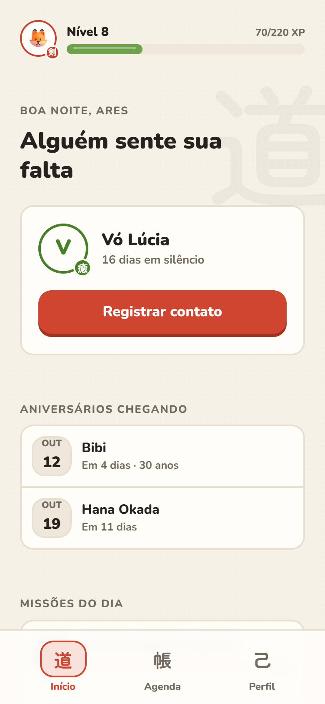
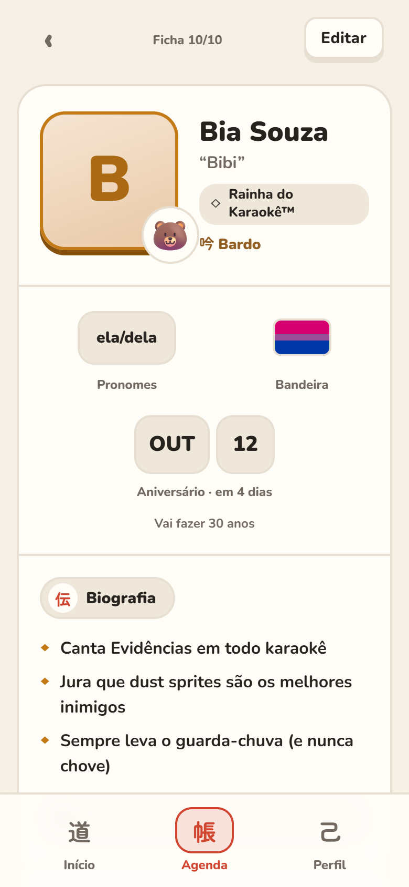
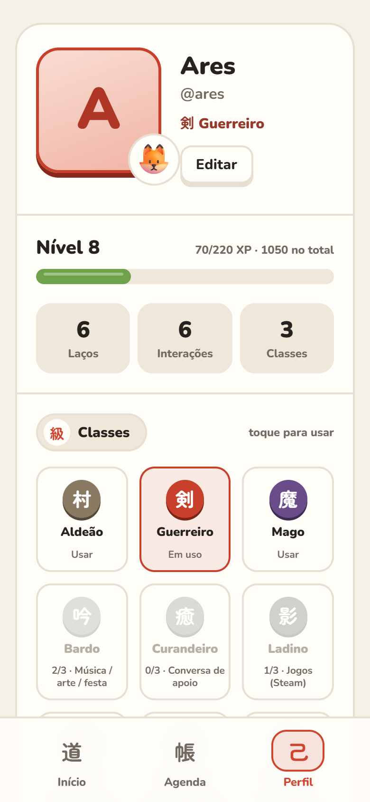
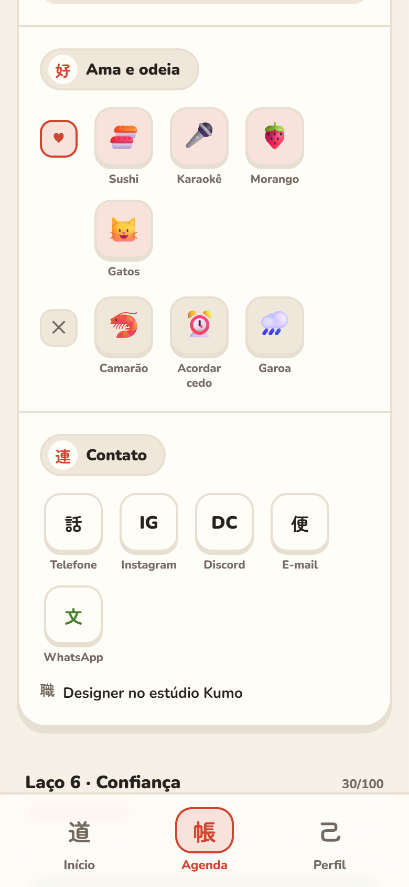
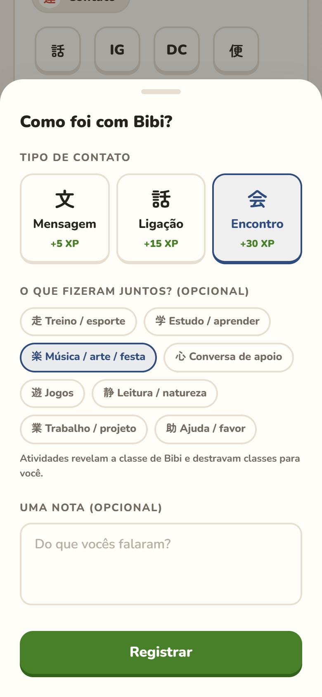
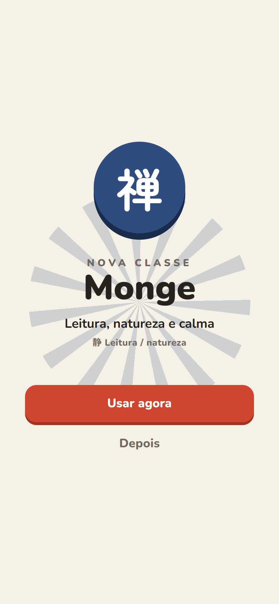
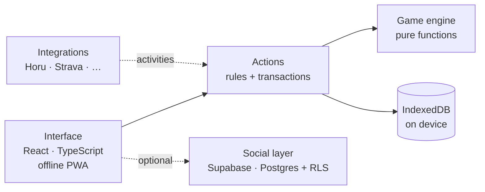

  

<h1 align="center">Kizuna 絆</h1>

  <b>A gamified contact book</b>: every person becomes an RPG card, keeping in touch
  earns XP and friendships level up. Japanese minimalism (<i>ma</i>) with Duolingo's
  rounded, chunky feel.

  <a href="README.md">Português</a> ·
  <a href="ARCHITECTURE.en.md"><b>Architecture</b></a> ·
  Personal project · Local-first PWA · Source in a private repository

---

  
  &nbsp;
  
  &nbsp;
  

The app's interface is in Portuguese.

## Why

Contact books are dead lists: you only open them to copy a number. I wanted the
opposite, a contact book that reminds me to **take care of people**: who's gone quiet,
whose birthday is next week, what each one loves.

Kizuna turns that into a light game. Every contact gets a **character card** (portrait,
guardian spirit, title, bio, loves and hates, full contact info). Every message, call or
meetup earns XP and strengthens the **bond**. Anyone left in silence for too long starts
to **fade**, like ink drying on paper.

## What it does

| | |
|---|---|
| **Profile card** | portrait with a guardian spirit beside it, pronouns, pride flag, birthday (with countdown), bullet-point bio, "loves and hates" as icons, contact tiles |
| **Full contact info** | multiple phones, emails and socials per person; WhatsApp, address on the map and workplace one tap away |
| **Bonds that level up** | 11 affinity levels, from *Loose thread* to *Legendary bond*, with a per-person cadence (week, month, season) |
| **Fading ink** | anyone past their cadence cools down and loses color; the home screen shows who misses you |
| **Classes** | everyone starts as a **Villager 村**; activities done together reveal each person's class (Warrior, Mage, Bard…) and unlock classes for you |
| **Integrations** | Horu, Strava, Goodreads, Steam and GitHub feed your classes (manual logging in the beta; the sync entry point is already in place) |
| **Daily quests** | three quests drawn from the date, with an XP chest |
| **Optional social layer** | allies by invite (link or QR), titles given by friends that become rarer as more friends repeat them |
| **Washi and Yoru themes** | light and dark, with contrast checked in both |

  
  &nbsp;
  
  &nbsp;
  

## Engineering decisions

- **Local-first.** Cards, notes and history live in the device's IndexedDB: it works
  offline, with no account and no server. The app is an installable PWA.
- **Social is optional and minimal.** When enabled, the cloud only holds what must be
  shared (public profile, friendships, invites, titles). Private nicknames and notes about
  someone never leave the device.
- **Pure game engine.** XP, levels, affinity, cadence, classes, quests and title rarity
  are pure functions, with no UI or database, tested in isolation.
- **XP as a ledger.** XP is the sum of entries, not a loose counter, which keeps
  anti-farming, quests and backups consistent.
- **Security in the database, not the client.** In the social layer every rule (who sees
  what, who can give a title, blocking) is a Postgres RLS policy, and sensitive operations
  are database functions. Those rules are tested against a real Postgres.
- **Gamify without making it awkward.** Pronouns and flag are optional and never earn XP.
  Titles from friends show up instantly, but the owner can hide, remove or block.

➡️ **[Architecture in depth](ARCHITECTURE.en.md)**: the data model, the game engine step
by step, how classes work, social-layer security, schema evolution without data loss, the
design system and the trade-offs behind each choice.

## Quality

| Layer | How it's verified |
|---|---|
| Game engine | 35 pure-function tests: XP, anti-farming, level curve, affinity, cadence, classes, quests, rarity |
| Local data | 18 tests over a simulated IndexedDB: transactions, integrations, backup and the **v1 → v2 database migration** |
| Contacts and social | 11 tests: birthdays (including Feb 29), contact links, title moderation and ally sync |
| **Database security** | 22 tests that run the migration on a **real Postgres (PGlite/WASM)** and try to break the rules: viewing a stranger's profile, giving a title without friendship, editing what isn't yours |
| **Real use** | full flows in a real browser, at phone size, in light and dark themes |

86 automated tests, strict typing. Real-browser testing caught what unit tests didn't:
exit animations freezing while the window was hidden, an icon row clipped on a 390 px
screen, and class colors with poor contrast in the dark theme.

## Tech

**TypeScript** · React 19 · Vite · Tailwind CSS 4 · Motion · React Router ·
**Dexie (IndexedDB)** · TanStack Query · **Supabase** (Postgres, Auth, RLS) ·
vite-plugin-pwa (Workbox) · Vitest · PGlite · Playwright

## Status

Beta in personal use, running 100% locally. The social layer is implemented with its
security rules tested, waiting for a Supabase project to go live. Next: real integration
sync (Horu pushing sessions; Strava via OAuth with a minimal server) and the first testers.

## Access to the code

The source code lives in a **private repository**. If you're a recruiter or evaluating
my work, I can grant read access:

1. email me with the subject **"Kizuna access"**;
2. mention the company or hiring process and your **GitHub username**.

Happy to walk through the code in an interview as well.

## Contact

**Ares** · [LinkedIn](https://www.linkedin.com/in/aresd-dev) · [aresd.dev@gmail.com](mailto:aresd.dev@gmail.com?subject=Kizuna%20access)

© 2026 Ares. Images and text on this page: all rights reserved. Kizuna's source code is not public.
Contacts in the screenshots are fictional.
