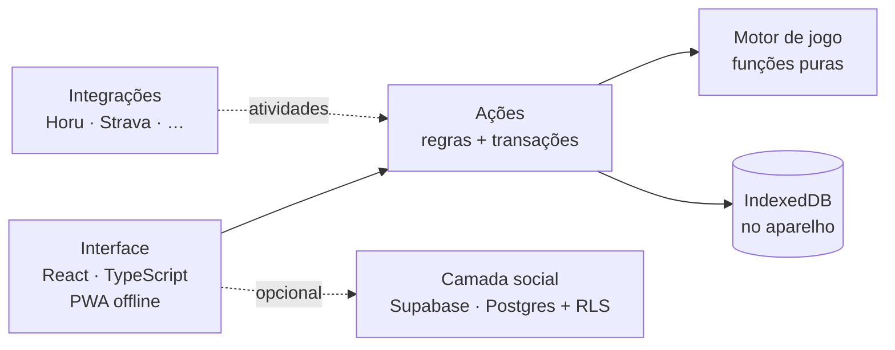

  

<h1 align="center">Kizuna 絆</h1>

  <b>Agenda de contatos gamificada</b>: cada pessoa vira um card de RPG, manter contato
  rende XP e as amizades sobem de nível. Minimalismo japonês (<i>ma</i>) com o volume
  arredondado do Duolingo.

  <a href="README.en.md">English</a> ·
  <a href="ARQUITETURA.md"><b>Arquitetura</b></a> ·
  Projeto pessoal · PWA local-first · Código em repositório privado

---

  
  &nbsp;
  
  &nbsp;
  

## Por que existe

Agendas de contatos são listas mortas: a gente só abre para copiar um número. Eu queria
o contrário, uma agenda que me lembrasse de **cuidar das pessoas**: quem está sumido,
quem faz aniversário semana que vem, do que cada um gosta.

O Kizuna transforma isso num jogo leve. Cada contato tem um **card de personagem**
(retrato, espírito guardião, título, biografia, o que ama e o que odeia, contato
completo). Cada conversa, ligação ou encontro rende XP e fortalece o **laço**. Quem fica
tempo demais em silêncio começa a **desbotar**, como tinta secando no papel.

## O que faz

| | |
|---|---|
| **Card de perfil** | retrato com o espírito guardião ao lado, pronomes, bandeira, aniversário (com contagem regressiva), biografia em tópicos, "ama e odeia" em ícones e tiles de contato |
| **Contato completo** | vários telefones, e-mails e redes por pessoa; WhatsApp, mapa do endereço e trabalho/estudo a um toque |
| **Laços que sobem de nível** | 11 níveis de afinidade, de *Fio solto* a *Laço lendário*, com cadência por pessoa (semana, mês, estação) |
| **Tinta que desbota** | quem passa da cadência esfria e perde cor; a tela inicial mostra quem sente sua falta |
| **Classes** | todo mundo começa **Aldeão 村**; atividades feitas juntos revelam a classe de cada pessoa (Guerreiro, Mago, Bardo…) e desbloqueiam classes para você |
| **Integrações** | Horu, Strava, Goodreads, Steam e GitHub alimentam suas classes (no beta, registro manual; a sincronização já tem porta de entrada pronta) |
| **Missões do dia** | três missões sorteadas pela data, com baú de XP |
| **Camada social opcional** | aliados por convite (link ou QR), títulos dados por amigos que ficam mais raros quando vários repetem |
| **Tema Washi e Yoru** | claro e escuro, com contraste calculado nos dois |

  
  &nbsp;
  
  &nbsp;
  

## Decisões de engenharia

- **Local-first.** Fichas, notas e histórico ficam no IndexedDB do aparelho: funciona
  offline, sem conta e sem servidor. O app é um PWA instalável.
- **Social é opcional e mínimo.** Quando ligada, a nuvem guarda só o que precisa ser
  compartilhado (perfil público, amizades, convites, títulos). O apelido privado e as
  notas sobre alguém nunca saem do aparelho.
- **Motor de jogo puro.** XP, níveis, afinidade, cadência, classes, missões e raridade
  de títulos são funções puras, sem interface nem banco, testadas isoladamente.
- **XP como livro-razão.** O XP é a soma de lançamentos, não um contador solto. Isso
  torna o anti-farm, as missões e os backups consistentes.
- **Segurança no banco, não no cliente.** Na camada social, cada regra (quem vê o quê,
  quem pode dar título, bloqueio) é uma política de RLS no Postgres, e as operações
  sensíveis são funções no próprio banco. Essas regras são testadas num Postgres de verdade.
- **Gamificar sem constranger.** Pronomes e bandeira são opcionais e não rendem XP.
  Títulos dados por amigos aparecem na hora, mas o dono oculta, remove ou bloqueia.

➡️ **[Arquitetura em detalhe](ARQUITETURA.md)**: o modelo de dados, o motor de jogo
passo a passo, como as classes funcionam, a segurança da camada social, a evolução do
esquema sem perder dados, o design system e as renúncias de cada escolha.

## Qualidade

| Camada | Como é verificada |
|---|---|
| Motor de jogo | 35 testes de funções puras: XP, anti-farm, curva de nível, afinidade, cadência, classes, missões, raridade |
| Dados locais | 18 testes sobre um IndexedDB simulado: transações, integrações, backup e a **migração do banco v1 → v2** |
| Agenda e social | 11 testes: aniversários (inclusive 29/02), links de contato, moderação de títulos e sincronização de aliados |
| **Segurança do banco** | 22 testes que rodam a migration num **Postgres de verdade (PGlite/WASM)** e tentam burlar as regras: ver perfil de estranho, dar título sem amizade, editar o que não é seu |
| **Uso real** | fluxos completos num navegador de verdade, em tamanho de celular, nos temas claro e escuro |

São 86 testes automatizados, com tipagem estrita. O teste em navegador real pegou o que os
unitários não viam: animações de saída que congelavam com a janela oculta, uma fileira de
ícones cortada numa tela de 390 px e cores de classe sem contraste no tema escuro.

## Tecnologias

**TypeScript** · React 19 · Vite · Tailwind CSS 4 · Motion · React Router ·
**Dexie (IndexedDB)** · TanStack Query · **Supabase** (Postgres, Auth, RLS) ·
vite-plugin-pwa (Workbox) · Vitest · PGlite · Playwright

## Status

Beta em uso pessoal, rodando 100% local. A camada social está implementada e com as
regras de segurança testadas, esperando um projeto Supabase para ir ao ar. Próximos
passos: sincronização real das integrações (o Horu enviando sessões; Strava por OAuth com
um servidor mínimo) e os primeiros testers.

## Acesso ao código

O código-fonte fica num **repositório privado**. Se você é recrutador(a) ou está
avaliando meu trabalho, posso liberar acesso de leitura:

1. me mande um e-mail com o assunto **"Acesso ao Kizuna"**;
2. diga a empresa ou o processo seletivo e o seu **usuário do GitHub**.

Também posso mostrar e conversar sobre o código numa entrevista.

## Contato

**Ares** · [LinkedIn](https://www.linkedin.com/in/aresd-dev) · [aresd.dev@gmail.com](mailto:aresd.dev@gmail.com?subject=Acesso%20ao%20Kizuna)

© 2026 Ares. Imagens e texto desta página: todos os direitos reservados. O código-fonte do Kizuna não é público.
Os contatos nas capturas são fictícios.
